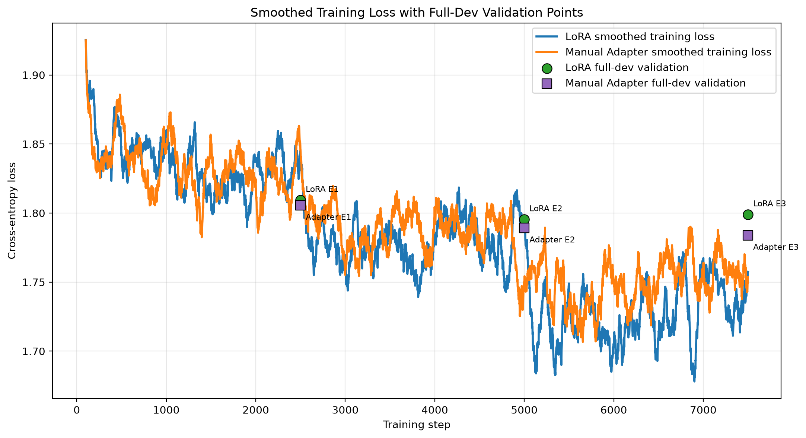
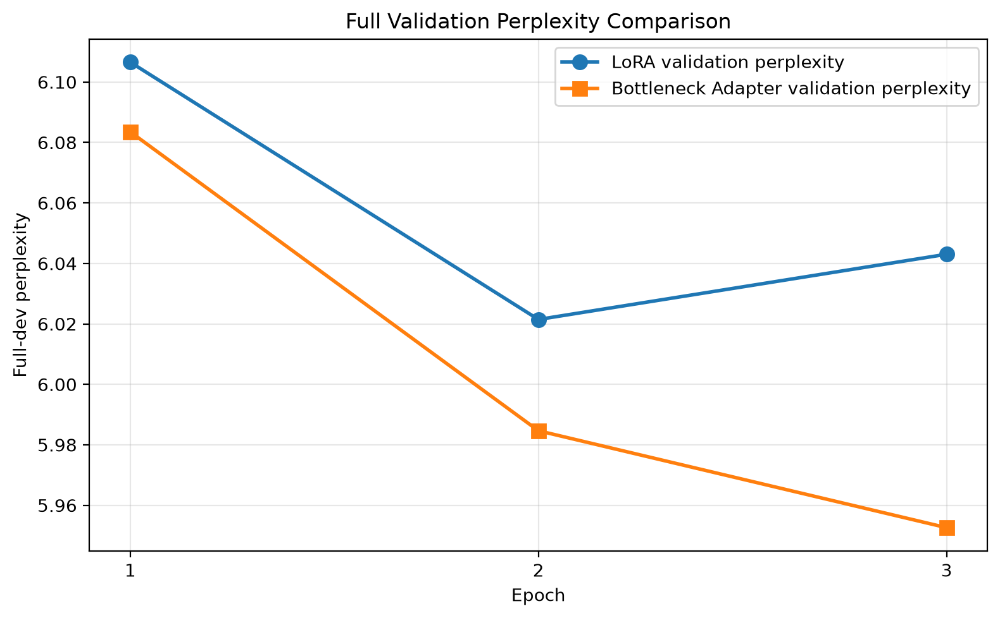

# LoRA vs. Hand-Built Bottleneck Adapters on Gemma 3n: Domain Adaptation and Catastrophic Forgetting

This project fine-tunes **Gemma 3n E2B** on Persian news with two parameter-efficient methods and measures what the model gains in-domain and what it loses out-of-domain (Wikipedia):

- **LoRA** with the `peft` library, applied to the `q/k/v/o` attention projections (r = 16, α = 32)
- **Bottleneck adapters written from scratch in PyTorch** (Linear → GELU → Linear with a residual connection), inserted after the MLP of each of the 30 transformer blocks, with the base model frozen

Both methods use the same training loop, written in plain PyTorch: learning rate 2e-4, 3 epochs, effective batch size 8, max length 256. Perplexity is computed by hand from summed token cross-entropy, with padding excluded.

Assignment for **Advanced Natural Language Processing** (Dr. Zeinali), Amirkabir University of Technology, Spring 2026.

## Results

| Model | Trainable params | News PPL ↓ (in-domain) | Wikipedia PPL ↓ (out-of-domain) | Wikipedia degradation |
|---|---|---|---|---|
| Base Gemma 3n E2B | – | 7.71 | 7.34 | – |
| LoRA | 5.57 M (0.103%) | 6.06 | 9.80 | +33.6% |
| Manual adapters | **2.03 M (0.037%)** | **5.97** | **8.80** | **+19.9%** |

Degradation = (PPL<sub>fine-tuned</sub> − PPL<sub>base</sub>) / PPL<sub>base</sub> on the Wikipedia test set.

With about 36% as many trainable parameters as LoRA, the bottleneck adapters reached slightly lower in-domain perplexity and lost much less out-of-domain performance. Both methods show clear catastrophic forgetting. The report discusses why the two placements behave differently and how the drop could be reduced.

| Method | Training time (3 epochs) | Peak training VRAM |
|---|---|---|
| LoRA | 4.0 h | 15.4 GB |
| Manual adapters | 3.1 h | 15.3 GB |

LoRA's validation perplexity reached its minimum after epoch 2 and rose slightly in epoch 3 (6.02 → 6.04), while the adapters kept improving through epoch 3 (5.95).




`results/generation_comparison.csv` holds side-by-side generations from all three models for Persian news prompts.

## Repository structure

```text
.
├── PEFT.ipynb                  # Full pipeline: baseline, LoRA, adapters, evaluation, report figures
├── outputs/
│   ├── lora_adapter/           # Trained LoRA weights (peft format)
│   ├── manual_adapters.pt      # Trained bottleneck-adapter weights
│   └── manual_adapter_config.json
├── results/                    # Perplexities, parameter counts, resource usage, curves, generations
├── datasets/                   # Not included (see below)
└── report/report_fa.pdf        # Full report (Persian)
```

## Reproducing

```bash
pip install -r requirements.txt
jupyter lab PEFT.ipynb
```

- **Model:** the notebook downloads `google/gemma-3n-E2B` into `./model`. You need a Hugging Face token that has accepted the Gemma license (set `HF_TOKEN` or paste it when prompted).
- **Data:** the course's Persian news (in-domain) and Wikipedia (out-of-domain) splits are not redistributed here. Put them in `datasets/` as follows, or place a `datasets.zip` next to the notebook:

  ```text
  datasets/in_domain/{train,dev,test}.jsonl
  datasets/out_domain/{train,dev,test}.jsonl
  ```
- **Hardware:** with gradient checkpointing, training peaked at about 15.4 GB of GPU memory, so a 16 GB card is the minimum.

To load the trained LoRA adapter without retraining:

```python
from peft import PeftModel
from transformers import Gemma3nForConditionalGeneration
base = Gemma3nForConditionalGeneration.from_pretrained("google/gemma-3n-E2B")
model = PeftModel.from_pretrained(base, "outputs/lora_adapter")
```

## License

Code is released under the [MIT License](LICENSE). The adapter weights are derived from Gemma and also fall under the [Gemma Terms of Use](https://ai.google.dev/gemma/terms).
